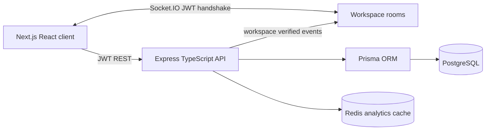

# SprintForge system architecture

## Data model

- **User**: hashed password, profile; belongs to many workspaces via Membership
- **Membership**: OWNER, ADMIN, MEMBER, VIEWER; composite unique `(userId,workspaceId)`
- **Workspace**: tenant boundary; projects belong to one workspace
- **Project**: workspace-scoped project key; many issues
- **Issue**: sequential number, status, priority, labels, assignee, reporter, timestamps
- **Comment**: author + issue reference; scoped through issue's project
- **Activity**: immutable-ish event appended for create/edit/comment; deleting an issue cascades its activities

## Request lifecycle

1. The frontend attaches a signed access JWT to API requests.
2. Protected routes verify the token, then look up workspace membership.
3. Prisma reads/writes the tenant-scoped data and validates assignment membership.
4. Mutations invalidate the workspace's analytics cache key and broadcast only to its verified WebSocket room.
5. The UI reloads relevant data on the event and renders optimistic status updates on the board.

## Known limitations

A single Express process owns the Socket.IO room state, in-memory cache hit counters, and request rate limiter. Multi-replica deployment would require a Redis Socket.IO adapter and shared rate limiter. JWTs are kept in localStorage in this demo; session hardening is required before public production use. The 'resolution proxy' metric is not a real state-transition-based cycle-time metric.
